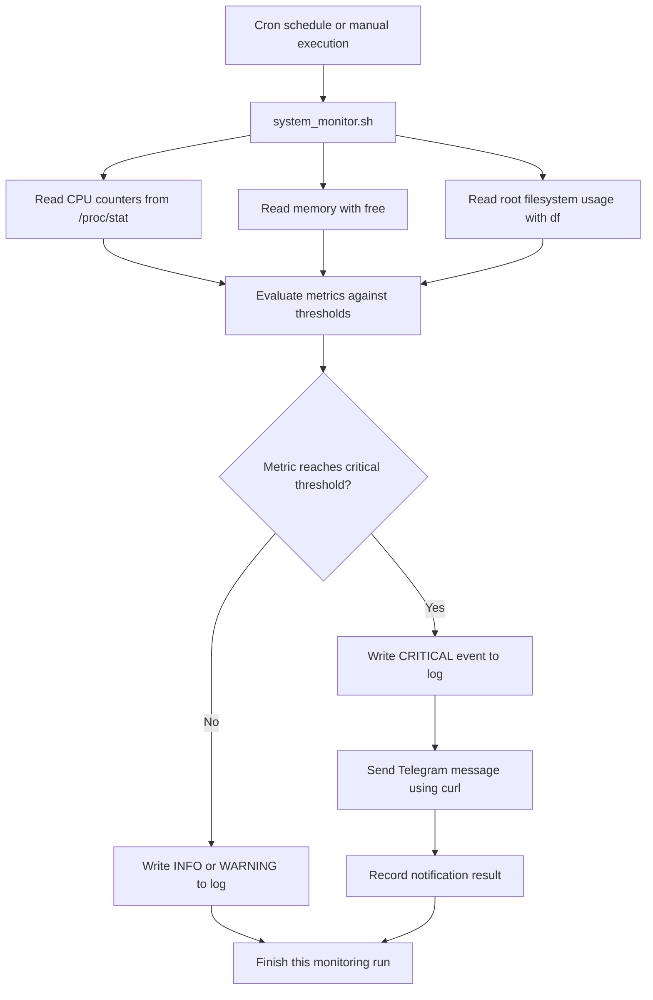
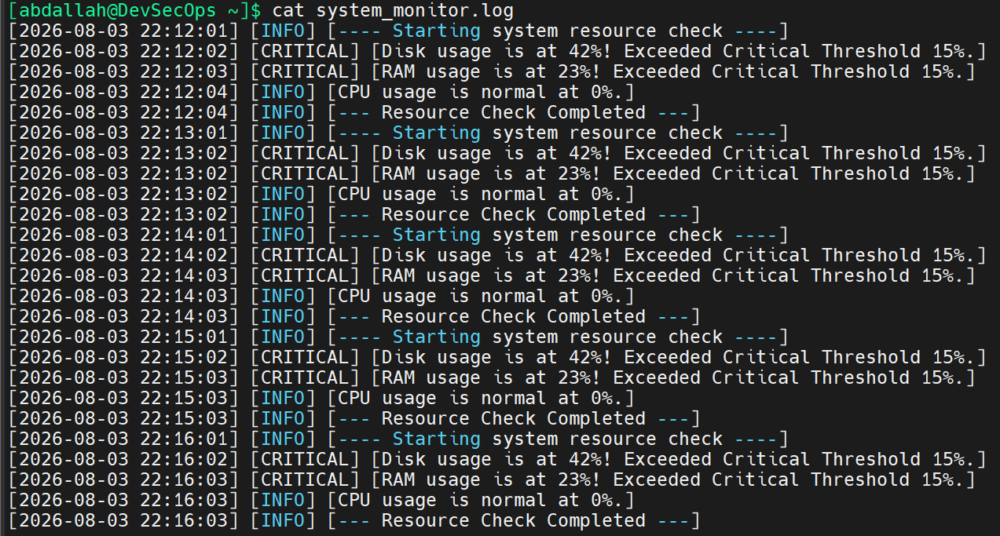
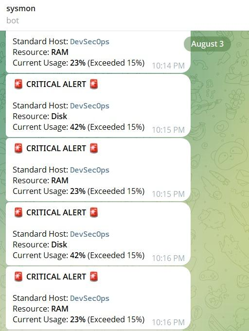

# Linux System Monitor & Telegram Alert Bot


A lightweight Linux monitoring lab written in Bash. It periodically checks **CPU utilization, RAM usage, and root filesystem usage**, records the results in a timestamped log, and sends a Telegram notification when a metric reaches its critical threshold.

The project demonstrates practical Linux administration and automation concepts: Bash scripting, process and resource inspection, threshold-based decisions, API integration with `curl`, log handling, workload testing, and Cron scheduling.

> **Project scope:** This is a learning and portfolio project for periodic host-health checks. It is not a replacement for a full observability stack such as Prometheus, exporters, and Grafana.

## Contents

- [Features](#features)
- [How It Works](#how-it-works)
- [Repository Structure](#repository-structure)
- [Requirements](#requirements)
- [Installation](#installation)
- [Telegram Configuration](#telegram-configuration)
- [Run the Monitor](#run-the-monitor)
- [Configuration Reference](#configuration-reference)
- [Schedule Checks with Cron](#schedule-checks-with-cron)
- [Testing and Validation](#testing-and-validation)
- [Log Examples and Screenshots](#log-examples-and-screenshots)
- [Troubleshooting](#troubleshooting)
- [Security Notes](#security-notes)
- [Current Limitations](#current-limitations)
- [Possible Improvements](#possible-improvements)

## Features

- **CPU monitoring:** Calculates CPU utilization from two snapshots of `/proc/stat`, taken one second apart.
- **Memory monitoring:** Calculates used memory from total memory and `MemAvailable`, rather than treating all filesystem cache as unavailable memory.
- **Disk monitoring:** Checks the percentage used on the filesystem that contains `/` (the root filesystem).
- **Configurable thresholds:** Separates warning and critical levels, with validation to ensure both are valid percentages and the warning level is lower than the critical level.
- **Telegram notifications:** Sends a plain-text alert through the Telegram Bot API when a metric reaches the critical threshold.
- **Timestamped logging:** Appends normal, warning, critical, and error events to a local log file while also printing them to the terminal.
- **Cron compatibility:** Can be scheduled to run automatically at a chosen interval without keeping a terminal open.
- **Workload testing:** Can be validated using controlled CPU and memory stress tests.

### Alert behavior

| Condition | Log level | Telegram notification |
|---|---|---|
| Usage below warning threshold | `INFO` | No |
| Usage at or above warning threshold, but below critical | `WARNING` | No |
| Usage at or above critical threshold | `CRITICAL` | Yes |
| Telegram configuration or request problem | `ERROR` | Not delivered; error is logged |

A critical alert is sent on every execution while the metric remains critical. This version does not implement alert deduplication or a cooldown period.

## How It Works



### Metric collection

| Resource | Source | Calculation / scope |
|---|---|---|
| CPU | `/proc/stat` | Uses the change in aggregate CPU counters between two samples one second apart. Idle and I/O-wait time are excluded from busy time. |
| RAM | `free -b` | `(MemTotal - MemAvailable) / MemTotal × 100` |
| Disk | `df -P /` | Reads the percentage used by the filesystem mounted at `/`. |

The script performs a one-second CPU sampling interval on each run. RAM and disk readings are collected during the same execution.

## Repository Structure

```text
linux-system-monitor-telegram-bot/
├── system_monitor.sh       # Main Bash monitoring script
├── .env.example            # Safe configuration template (no real credentials)
├── .gitignore              # Excludes secrets and runtime logs
├── README.md               # Project documentation
└── docs/
    └── images/
        ├── terminal-monitoring-log.png
        └── telegram-critical-alerts.png
```

The real `.env` file is created locally during setup and is intentionally excluded from Git.

## Requirements

- A Linux host or virtual machine.
- Bash.
- `awk`, `date`, `df`, `free`, `hostname`, `sleep`, and `tee` (normally available on standard Linux installations).
- `curl` for Telegram notifications.
- A Telegram account and a bot created with [@BotFather](https://t.me/BotFather).
- Optional: the `stress` utility for workload testing.
- Optional: Cron for scheduled execution.

### Install required packages

**Ubuntu / Debian**

```bash
sudo apt update
sudo apt install -y curl procps
```

**RHEL / CentOS Stream / Fedora**

```bash
sudo dnf install -y curl procps-ng
```

`procps` / `procps-ng` provides the `free` command on these distributions.

## Installation

Clone the repository and enter its directory:

```bash
git clone https://github.com/<YOUR_GITHUB_USERNAME>/linux-system-monitor-telegram-bot.git
cd linux-system-monitor-telegram-bot
```

Create your private configuration file from the template:

```bash
cp .env.example .env
nano .env
```

Add your Telegram values and review the thresholds. Then restrict access to the configuration file:

```bash
chmod 600 .env
```

Make the script executable and check its Bash syntax:

```bash
chmod +x system_monitor.sh
bash -n system_monitor.sh
```

`bash -n` checks syntax without running the monitoring commands.

## Telegram Configuration

### 1. Create a Telegram bot

1. Open Telegram and start a conversation with [@BotFather](https://t.me/BotFather).
2. Send `/newbot` and follow the prompts.
3. Save the token generated by BotFather in a secure location.
4. Open your new bot and press **Start** or send it `/start`.

A user must contact a bot before the bot can start a private conversation with that user. See the [official Telegram bot tutorial](https://core.telegram.org/bots/tutorial).

### 2. Obtain the chat ID

For a private chat, you can use a Telegram ID helper such as [@userinfobot](https://t.me/userinfobot) to retrieve your numeric user ID. Use that value as `TELEGRAM_CHAT_ID`.

For a group, add the bot to the group and use the group's chat ID. Make sure the bot has permission to send messages there.

### 3. Add the values to `.env`

Edit the local `.env` file:

```bash
TELEGRAM_BOT_TOKEN="YOUR_NEW_BOT_TOKEN"
TELEGRAM_CHAT_ID="YOUR_CHAT_ID"

WARNING_THRESHOLD=70
CRITICAL_THRESHOLD=90
```

Do not put real credentials in `README.md`, `.env.example`, screenshots, shell scripts, or any file that will be committed to Git.

The script uses Telegram's official [`sendMessage`](https://core.telegram.org/bots/api#sendmessage) method. It URL-encodes the message fields with `curl` and checks the HTTP request result before logging successful delivery.

## Run the Monitor

Run the script manually:

```bash
./system_monitor.sh
```

Example terminal output (values are illustrative):

```text
[2026-11-25 18:30:01] [INFO] ----- Starting system resource check -----
[2026-11-25 18:30:02] [INFO] Disk usage is normal at 42%.
[2026-11-25 18:30:02] [WARNING] RAM usage is 76% (warning threshold: 70%).
[2026-11-25 18:30:02] [CRITICAL] CPU usage is 93% (critical threshold: 90%).
[2026-11-25 18:30:03] [INFO] Telegram critical alert delivered for CPU.
[2026-11-25 18:30:03] [INFO] ----- Resource check completed -----
```

The actual values and timestamps depend on the host. The example above illustrates the log format; it is not a captured measurement.

View the log continuously:

```bash
tail -f system_monitor.log
```

The log file is created in the repository directory by default. You can change its location with the optional `LOG_FILE` setting in `.env`.

## Configuration Reference

| Variable | Default | Description |
|---|---:|---|
| `TELEGRAM_BOT_TOKEN` | Empty | Bot token issued by BotFather. Required for Telegram delivery. |
| `TELEGRAM_CHAT_ID` | Empty | User, group, or channel chat ID that receives alerts. |
| `WARNING_THRESHOLD` | `70` | Usage percentage at which a warning is written to the log. |
| `CRITICAL_THRESHOLD` | `90` | Usage percentage at which a critical event is logged and Telegram is notified. |
| `LOG_FILE` | `system_monitor.log` beside the script | Path to the log file. Use an absolute path when overriding it for scheduled execution. |

Thresholds must be integer percentages from `0` to `100`, and `WARNING_THRESHOLD` must be lower than `CRITICAL_THRESHOLD`.

The default thresholds are starting values, not universal recommendations. Adjust them to match the host's normal workload and available resources.

## Schedule Checks with Cron

Cron can execute the script periodically in the background. The example below runs it every five minutes.

First, identify the script's absolute path and the Bash location:

```bash
pwd
command -v bash
```

Open your user crontab:

```bash
crontab -e
```

Add a line using the actual absolute paths from your machine. For example:

```cron
*/5 * * * * /bin/bash /home/USER/linux-system-monitor-telegram-bot/system_monitor.sh >> /home/USER/linux-system-monitor-telegram-bot/cron.log 2>&1
```

Replace `/bin/bash` if `command -v bash` returns a different path, and replace `/home/USER/...` with your actual repository path.

Verify the installed entry:

```bash
crontab -l
```

Check Cron's captured output and the application's log:

```bash
tail -f cron.log
tail -f system_monitor.log
```

The script locates `.env` relative to its own file, so it can load the configuration when started by Cron. The log file defaults to the script's directory rather than Cron's working directory.

To stop scheduled execution, open `crontab -e` and remove the corresponding line.

### Cron expression reference

A standard user crontab entry has five time fields followed by the command:

```text
┌──────────── minute (0-59)
│ ┌────────── hour (0-23)
│ │ ┌──────── day of month (1-31)
│ │ │ ┌────── month (1-12)
│ │ │ │ ┌──── day of week (0-7; Sunday may be 0 or 7)
│ │ │ │ │
* * * * * command
```

| Symbol | Meaning | Example |
|---|---|---|
| `*` | Every valid value | `* * * * *` - every minute |
| `,` | A list of values | `0 8,12,16 * * *` - at 08:00, 12:00, and 16:00 |
| `-` | A range | `0 9-17 * * *` - at the start of each hour from 09:00 through 17:00 |
| `*/n` | A step / interval | `*/15 * * * *` - every 15 minutes |

## Testing and Validation

> **Safety:** Run stress tests on a disposable VM or a non-production machine. Memory stress can cause swapping or an out-of-memory event if the requested allocation is too large.

### Install the stress utility

**Ubuntu / Debian**

```bash
sudo apt update
sudo apt install -y stress
```

**RHEL / CentOS Stream / Fedora**

```bash
sudo dnf install -y stress
```

### CPU stress test

In Terminal 1, generate CPU load across the available logical CPUs for 40 seconds:

```bash
stress --cpu "$(nproc)" --timeout 40s
```

While the test is running, execute the monitor in Terminal 2:

```bash
./system_monitor.sh
```

Review `system_monitor.log` and the Telegram chat. With the default critical threshold, a notification is expected only if the measured CPU usage reaches 90% or higher during the one-second CPU sampling interval.

### Memory stress test

The following example starts two workers, each requesting 256 MB, for a total requested allocation of approximately 512 MB:

```bash
stress --vm 2 --vm-bytes 256M --timeout 30s
```

Run the monitor in another terminal while the workload is active. Adjust the allocation carefully based on the VM's available memory; do not copy large memory values blindly.

### Static syntax check

```bash
bash -n system_monitor.sh
```

For additional static analysis, install [ShellCheck](https://www.shellcheck.net/) and run:

```bash
shellcheck system_monitor.sh
```

A successful syntax check does not prove that Telegram credentials, network access, Cron, or notification delivery are configured correctly. Those parts must be tested in the target environment.

## Log Examples and Screenshots

The screenshots below were taken during the original lab exercise and show the terminal log and Telegram notifications working together.

**Important context:** The original captured run displayed a 15% critical threshold. The updated script in this repository uses configurable thresholds and defaults to 70% warning / 90% critical. The screenshots are retained as historical lab evidence, not as a representation of the new default configuration.

### Terminal monitoring log



### Telegram critical alerts



## Troubleshooting

| Symptom | Possible cause | What to check |
|---|---|---|
| No Telegram message | Metric did not reach the critical threshold | Warning events are logged only; Telegram is used for critical events. |
| No Telegram message | Bot has not been started by the recipient | Open the bot in Telegram and send `/start`. |
| No Telegram message | Incorrect token or chat ID | Recheck the values in `.env`; regenerate an exposed token in BotFather. |
| No Telegram message | Network or `curl` problem | Confirm that `curl` is installed and the host can reach the Telegram Bot API over HTTPS. |
| Script exits with a threshold error | Invalid threshold values | Use integer percentages from 0 to 100, with warning lower than critical. |
| Script cannot write its log | Insufficient filesystem permissions | Check the directory and file permissions; choose a writable absolute `LOG_FILE` path. |
| Works manually but not in Cron | Incorrect command path or Cron environment | Use absolute paths, inspect `cron.log`, and verify the user's crontab with `crontab -l`. |
| Too many repeated Telegram messages | Critical condition remains active across Cron runs | This version sends an alert on each critical run; it has no cooldown or alert-state tracking. |

## Security Notes

- **Never commit `.env`.** It is excluded by `.gitignore`; keep its file permissions restrictive with `chmod 600 .env`.
- **Never publish a real Telegram bot token.** Anyone who obtains it may control the bot. If a token has appeared in a document, screenshot, terminal recording, Git commit, or public repository, revoke/regenerate it using BotFather.
- The original lab PDF supplied with this project contains a hardcoded Telegram token. **Do not upload that original PDF to GitHub.** Revoke the exposed token before configuring this version of the project.
- Removing a secret from the latest file is not enough if it was already committed: rotate the credential first, then remove the secret from repository history where necessary.
- Do not place real credentials in command examples, issue reports, screenshots, or public discussions.

## Current Limitations

- Disk monitoring is limited to the filesystem containing `/`; other mounted volumes are not checked.
- Monitoring is periodic. Short-lived spikes between scheduled runs may be missed.
- Warning-level events are logged but do not generate Telegram messages.
- Critical alerts are repeated on each execution while the threshold remains exceeded; there is no cooldown or recovery notification.
- The log file has no built-in rotation or retention policy.
- CPU collection depends on Linux `/proc/stat`; memory collection expects the `MemAvailable` field provided by modern `free` implementations.

## Possible Improvements

Potential next steps for extending the lab:

- Add per-mount disk monitoring and configurable monitored paths.
- Add alert cooldowns, state tracking, and recovery notifications.
- Make warning-level Telegram notifications configurable.
- Add log rotation and retention using `logrotate`.
- Add automated tests for metric parsing and threshold decisions.
- Add ShellCheck to a GitHub Actions workflow.
- Support a `systemd` timer as an alternative to Cron.

---

**Author:** Abdallah Elsayed  
**Project:** Linux System Monitor & Telegram Alert Bot  
**Purpose:** Linux administration, Bash scripting, monitoring, API integration, and automation practice.


