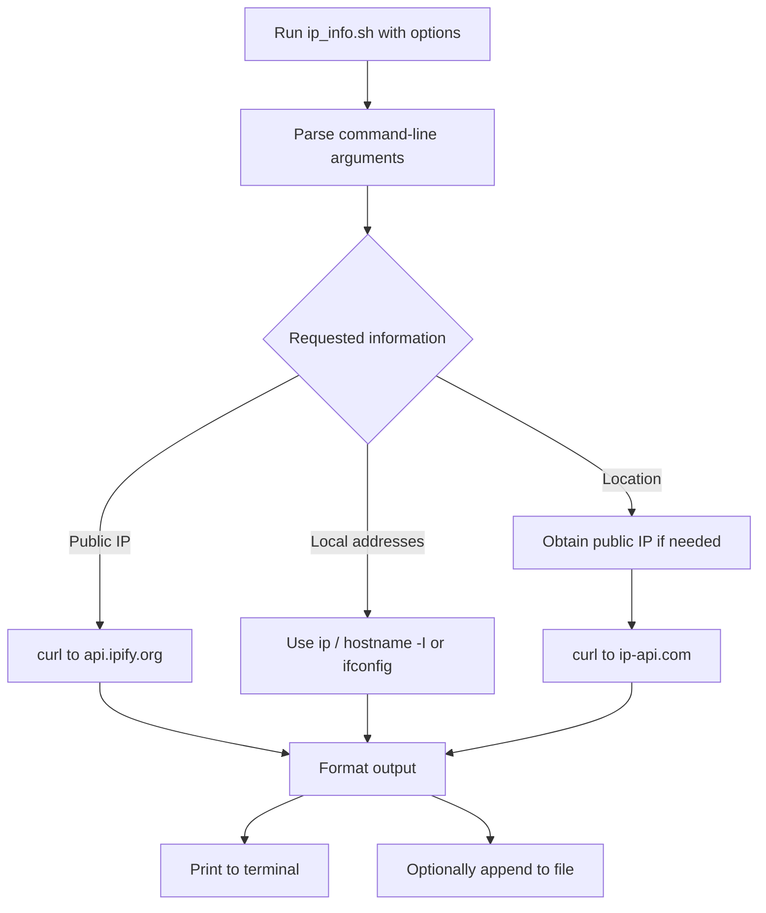

# IP Information Utility

A lightweight Bash command-line utility for retrieving public IP information, displaying local network interface addresses, and looking up approximate geolocation details for the public IP address.

The script is designed for hands-on Linux administration and shell-scripting practice. It combines native networking commands with HTTP requests to external IP-information services and supports both terminal output and file logging.

> **Implementation note:** This README documents the script as supplied. A few advertised options have implementation limitations; these are called out explicitly in [Known limitations](#known-limitations-and-recommended-fixes) so users are not misled.

## Contents

- [Features](#features)
- [How it works](#how-it-works)
- [Requirements](#requirements)
- [Installation](#installation)
- [Usage](#usage)
- [Options](#options)
- [Examples](#examples)
- [Output formats](#output-formats)
- [Saving output](#saving-output)
- [External services and privacy](#external-services-and-privacy)
- [Known limitations and recommended fixes](#known-limitations-and-recommended-fixes)
- [Troubleshooting](#troubleshooting)
- [Project structure](#project-structure)
- [Learning outcomes](#learning-outcomes)

## Features

- **Public IP lookup:** Retrieves the public-facing IP address using `api.ipify.org`.
- **Local address discovery:** Displays addresses reported by the host's networking utilities.
- **Interface-specific lookup:** Retrieves an address for a named network interface.
- **IP geolocation lookup:** Requests approximate country, region, city, postal code, coordinates, and ISP information for the public IP.
- **Multiple output modes:** Supports human-readable terminal output and an intended JSON mode.
- **File output:** Can append command output to a file while continuing to display it in the terminal.
- **CLI argument handling:** Provides short and long options, help text, and version information.
- **Linux/macOS branches:** Uses `ip`/`hostname` on Linux and `ifconfig` on macOS.

## How it works

The script follows this high-level flow:



### Data sources

| Information | Source / command | Purpose |
|---|---|---|
| Public IP | `https://api.ipify.org` | Returns the public IP observed by the external service. |
| Geolocation | `http://ip-api.com/json/<IP>` | Returns approximate IP-based location and ISP metadata. |
| Linux interface address | `ip addr show <interface>` | Reads address information for a selected interface. |
| Linux local addresses | `hostname -I` | Lists IP addresses configured on the host. |
| macOS interface address | `ifconfig <interface>` | Reads IPv4 address information for a selected interface. |
| macOS local addresses | `ifconfig` | Lists non-loopback IPv4 addresses found in the command output. |

## Requirements

### Required

- Bash
- `curl`
- Standard system utilities used by the script, including `awk`, `grep`, `sed`, and `cut`
- On Linux: `ip` and `hostname`
- On macOS: `ifconfig` (normally included with the operating system)

### Recommended

- `jq` for reliable JSON parsing and readable JSON output.

Although the original script labels `jq` as optional, some JSON paths invoke it directly. In particular, `--private --json` requires `jq`. The no-`jq` geolocation fallback also uses `grep -P`, which is not available in the default BSD `grep` on macOS. Install `jq` when using JSON output or macOS geolocation parsing.

## Installation

Clone the repository:

```bash
git clone https://github.com/<YOUR_GITHUB_USERNAME>/<YOUR_REPOSITORY>.git
cd <YOUR_REPOSITORY>
```

Make the script executable:

```bash
chmod +x ip_info.sh
```

### Install dependencies

**Ubuntu / Debian**

```bash
sudo apt update
sudo apt install -y curl jq iproute2
```

**RHEL / CentOS Stream / Fedora**

```bash
sudo dnf install -y curl jq iproute
```

**macOS with Homebrew**

```bash
brew install curl jq
```

`ifconfig` is provided by macOS. The script's macOS path uses it to read interface addresses.

## Usage

```bash
./ip_info.sh [OPTIONS]
```

When no information-selection option is provided, the script enables public IP, local IP addresses, and location lookup by default.

## Options

| Short option | Long option | Description |
|---|---|---|
| `-h` | `--help` | Display usage instructions and exit. |
| `-V` | `--version` | Display the script version. |
| `-p` | `--public` | Retrieve and display the public IP address. |
| `-l` | `--location` | Retrieve geolocation information for the public IP. |
| `-r` | `--private` | Display local IP addresses. |
| `-i IFACE` | `--interface IFACE` | Select a network interface when displaying local addresses. |
| `-a` | `--all` | Enable public IP, local address, and location information. |
| `-j` | `--json` | Request JSON output. See the limitation below before relying on it. |
| `-s FILE` | `--save FILE` | Append output to the specified file as well as displaying it. |

## Examples

### Display the public IP address

```bash
./ip_info.sh --public
```

### Display local IP addresses

```bash
./ip_info.sh --private
```

On Linux, this uses `hostname -I`; it may list addresses from several interfaces, including virtual or container interfaces. It does not strictly filter the results to RFC1918 IPv4 addresses.

### Display an address for one interface

```bash
./ip_info.sh --private --interface eth0
```

Replace `eth0` with an interface name that exists on your machine. **Important:** In the current implementation, `--interface` must be combined with `--private` (or `--all`) to trigger the private-address output section.

To list interface names on Linux:

```bash
ip link show
```

To list interface names on macOS:

```bash
ifconfig -l
```

### Display public-IP geolocation

```bash
./ip_info.sh --location
```

The script first obtains the public IP and then asks the geolocation service for information associated with that IP address.

### Display all available information

```bash
./ip_info.sh --all
```

### Save output to a file

```bash
./ip_info.sh --all --save ip-info-report.txt
```

The file is opened in append mode. Running the command again adds another report to the same file rather than replacing its previous contents.

### Display help and version

```bash
./ip_info.sh --help
./ip_info.sh --version
```

### JSON mode

The script includes a `--json` option:

```bash
./ip_info.sh --public --json
```

However, JSON output should currently be treated as experimental. See [Known limitations](#known-limitations-and-recommended-fixes) before using it in automation or piping it into another program.

## Output formats

### Human-readable output

A public-IP lookup prints a line similar to:

```text
Public IP: <PUBLIC_IP>
```

A location lookup prints fields in this form:

```text
Location Information:
Country: <COUNTRY>
Region: <REGION>
City: <CITY>
Postal Code: <POSTAL_CODE>
Latitude: <LATITUDE>
Longitude: <LONGITUDE>
ISP: <ISP>
```

Values depend on the network from which the script is run and on the response returned by the external services.

### JSON output

The `--json` option is present in the current script, but its output is not reliable for every combination of options. Do not treat it as a stable machine-readable interface until the limitations below have been fixed and the output has been validated with `jq`.

## Saving output

The `--save` option uses `tee -a`, so output is both displayed in the terminal and appended to the specified file.

Example:

```bash
./ip_info.sh --all --save "$HOME/ip-info-report.txt"
```

Choose a path that the current user can write to. Avoid saving reports in a public or shared directory because they may contain public IP and network information.

## External services and privacy

This tool contacts third-party services when public IP or geolocation information is requested:

1. `api.ipify.org` receives the request and returns the public IP observed by the service.
2. `ip-api.com` receives a lookup request containing that public IP and returns IP-based geolocation and ISP metadata.

Important considerations:

- A public IP address is network-identifying information. Use the tool only on networks where you are permitted to make these requests.
- IP geolocation is approximate. City, region, and coordinates should not be interpreted as a device's exact physical location or GPS position.
- The supplied script calls the geolocation endpoint over **HTTP**, not HTTPS. The lookup response is therefore not protected by TLS in transit. Review the provider's current API options and terms before using this in a sensitive environment.
- The script does not require API credentials for the endpoints currently configured in the source.
- Availability, response fields, and usage limits are controlled by the external providers and may change independently of this project.

## Known limitations and recommended fixes

The following points are based on the supplied source code and should be addressed before presenting every option as production-ready.

| Area | Current behavior | Recommendation |
|---|---|---|
| `--interface` by itself | Stores the interface name but does not enable the private-address output section. The command can finish without displaying the requested interface address. | Set `include_private_ip=true` when `--interface` is parsed, or always pair it with `--private` as shown in the examples. |
| JSON with `--location` | The JSON assembly logic constructs the `location` property incorrectly and can produce invalid JSON. | Build one JSON object from structured values (or use `jq -n` with explicit arguments) instead of concatenating JSON fragments. |
| JSON without `jq` | The private-address JSON path invokes `jq` directly even though the help text calls it optional. | Check for `jq` when `--json` is selected and return a clear dependency error, or implement JSON escaping without it. |
| Geolocation fallback parsing | The no-`jq` path uses `grep -P`, which is not portable to the default macOS `grep`; parsing JSON with `grep`/`sed` is also fragile. | Make `jq` a required dependency for geolocation parsing, or use a proper JSON parser. |
| HTTP error handling | `curl -s` suppresses progress output but does not fail for every HTTP error response; no explicit timeout is configured. | Use suitable `curl` flags such as `--fail`, `--show-error`, and `--max-time`, then handle failures explicitly. |
| Interface address classification | Linux `hostname -I` returns addresses assigned to the host, not necessarily only private IPv4 addresses. | Label the output as local interface addresses or filter addresses by family/scope if strict private-IP output is required. |
| Location transport | The geolocation request uses `http://`. | Use the provider's HTTPS endpoint when available for the account/API tier in use. |
| Dependency check order | The `curl` check runs before argument parsing, so even `--help` and `--version` fail when `curl` is missing. | Parse help/version first, then validate dependencies required by the selected operation. |

These are implementation notes, not features that have been tested or fixed by this documentation.

## Troubleshooting

### `curl` is required but not installed

Install `curl` using the package manager for your operating system, then rerun the command.

### Unable to retrieve the public IP address

Check that the machine has working internet connectivity and that outbound HTTPS requests are allowed. The public-IP service may also be temporarily unavailable.

### Unable to retrieve an address for an interface

Confirm the interface name:

```bash
ip link show       # Linux
ifconfig -l        # macOS
```

Then run the command with both options:

```bash
./ip_info.sh --private --interface <INTERFACE_NAME>
```

### `jq: command not found`

Install `jq`. It is needed by some JSON-output paths in the supplied implementation and is recommended for geolocation parsing.

### Location lookup fails

Check internet connectivity and the response from the geolocation provider. The provider may reject requests, enforce usage limits, or return an error status. IP-based location data may also be incomplete.

### Output file is not created

Check that the destination directory exists and that the current user has write permission:

```bash
mkdir -p "$HOME/reports"
./ip_info.sh --all --save "$HOME/reports/ip-info.txt"
```

## Project structure

```text
ip-info-tool/
├── ip_info.sh       # Bash implementation
├── README.md        # Project documentation
└── .gitignore       # Suggested Git exclusions
```

## Learning outcomes

This project demonstrates practical use of:

- Bash scripting fundamentals, including functions, local variables, conditionals, loops, and command-line argument parsing.
- Linux networking utilities such as `ip` and `hostname`.
- macOS network inspection through `ifconfig`.
- HTTP requests from shell scripts using `curl`.
- Processing command output with tools such as `awk`, `grep`, `sed`, and `cut`.
- Optional JSON processing with `jq`.
- Output redirection and process substitution with `tee`.
- Error handling with `set -euo pipefail`.

## Contributions and improvements

Useful future improvements include:

- Fixing interface-only selection and validating every option combination.
- Reworking JSON generation so every supported combination produces valid JSON.
- Adding reliable HTTP status checks, timeouts, and clearer error messages.
- Making address-family selection explicit (IPv4, IPv6, or both).
- Supporting multiple interfaces in one invocation.
- Adding automated tests using mocked command outputs and mocked HTTP responses.

## License

No license is currently specified. Add a `LICENSE` file before inviting reuse or contributions under an explicit open-source license.
